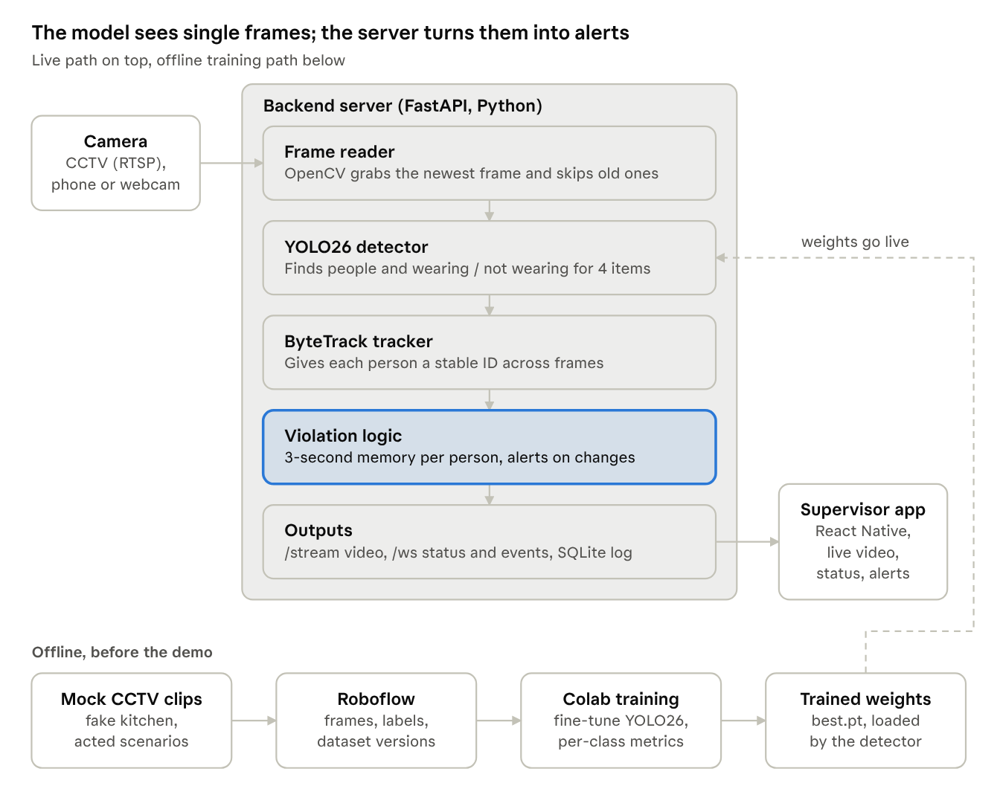

# Check (شيك): Live Staff Hygiene Monitoring

**Check watches a kitchen's CCTV feed live, follows every staff member, and alerts the supervisor the moment someone breaks a hygiene rule**, like taking off their gloves or pulling down their mask.

Food businesses must make staff wear masks, hairnets, gloves and a clean uniform. Today a supervisor checks this by eye, so there are gaps whenever they look away.



## What makes it more than a PPE detector

1. **Tracking:** we know *who* is missing an item, not just that a missing item exists somewhere in the frame
2. **Time logic:** "removed gloves" is a real event (had gloves, then lost them for a few seconds), not a flicker from one bad frame
3. **A product around it:** a web dashboard (live view, alert history, insights, model and evaluation results) and a mobile app that buzzes the supervisor

## Repository

| Folder | Contains |
|---|---|
| [`backend/`](backend/) | FastAPI server: camera reader, YOLO + ByteTrack, violation logic, SQLite, Dockerfile |
| [`dashboard/`](dashboard/) | Web dashboard (English + Arabic): Live, Alerts, Insights, Model, Evaluation, System |
| [`mobile/`](mobile/) | Expo React Native app: Connect, Live, Alerts |
| [`training/`](training/) | Training script, Colab notebook, class list, public-data remap, results table |
| [`evaluation/`](evaluation/) | Event-level scoring (caught %, false alarms, delay), ground truth CSVs |
| [`data/`](data/) | Recording plan, labeling rules, recording log (no videos in git) |
| [`docs/`](docs/) | Implementation plan, architecture diagram, decisions |

## Quick start (no model needed)

```bash
# backend with scripted detections and a synthetic camera
cd backend
pip install -r requirements-dev.txt
DETECTOR=fake CAMERA_SOURCE=synthetic uvicorn app.main:app --host 0.0.0.0 --port 8000

# web dashboard (another terminal): build once, then open http://localhost:8000/dashboard/
cd dashboard
npm install && npm run build

# phone app (another terminal)
cd mobile
npm install
npx expo start      # scan the QR code with Expo Go, enter <laptop-ip>:8000
```

Within a minute, Person 2 removes their gloves: the phone buzzes and the dashboard pops up an alert.

## Detector classes

`person`, plus wearing / not wearing for 3 items: `hairnet` `no_hairnet` · `mask` `no_mask` · `gloves` `no_gloves`. Hair is merged into hairnet (is the hair covered?). Uniform and nails are not checked: they can't be judged from CCTV height (see [`docs/decisions.md`](docs/decisions.md)).

## Workflow

1. **Record** mock-CCTV clips, split by video ([`data/README.md`](data/README.md))
2. **Label** in Roboflow with [`data/labeling_rules.md`](data/labeling_rules.md)
3. **Train** on Colab: [`training/train_colab.ipynb`](training/train_colab.ipynb). Results are logged to [`training/results.md`](training/results.md) and `training/results.json` (the dashboard's Model page)
4. **Evaluate** events: [`evaluation/README.md`](evaluation/README.md). `--json evaluation/results.json` fills the dashboard's Evaluation page
5. **Run** the backend with the real weights + the dashboard and app ([`backend/README.md`](backend/README.md))

Videos stay in the shared drive and Roboflow. Weights (`best.pt`, `best.onnx`) go in GitHub Releases.

## Tests

```bash
cd backend && pytest                    # violation logic, store, API
cd .. && pytest evaluation/tests        # event scoring
```

## Privacy

Anonymous IDs only (Person 1, Person 2). No face recognition. IDs are per camera session, not real identities. Footage stays local and is only recorded with consent.
