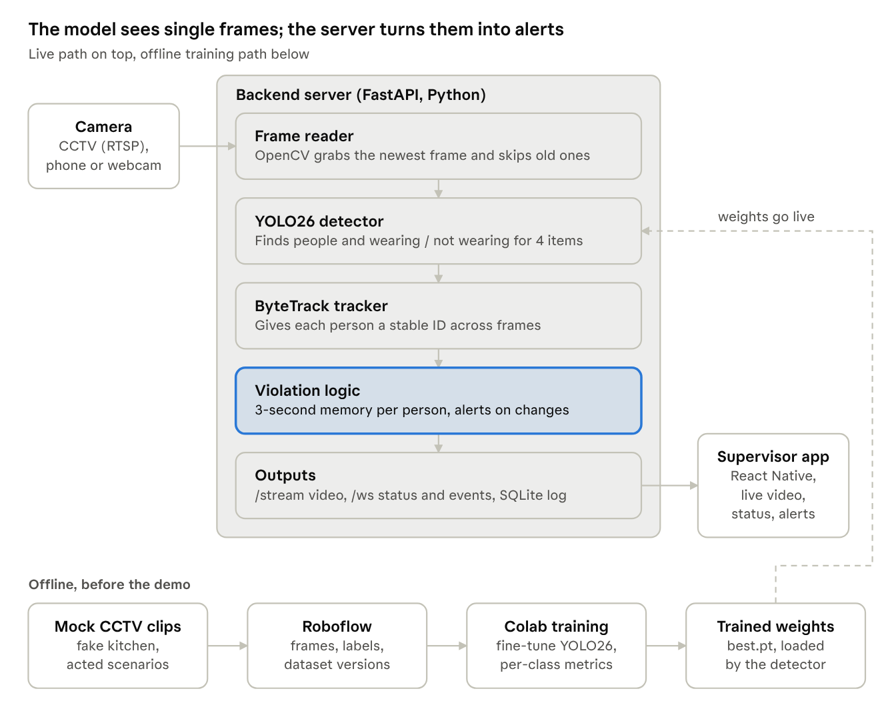

# Check (شيك): Live Staff Hygiene Monitoring, Implementation Plan

Nov 24, 2026 · @Omar Alshuail

## The idea

**Check watches a kitchen's CCTV feed live, follows every staff member,
and alerts the supervisor the moment someone breaks a hygiene rule**,
like taking off their gloves or pulling down their mask.

**The problem.** Food businesses must make staff wear masks, hairnets,
gloves and a clean uniform. Today a supervisor checks this by eye, which
means gaps whenever they look away. Inspectors and customers only see
the moments someone was watching.

**What the system does.**

- Reads a live camera stream (we simulate CCTV with a phone or webcam
  mounted high).

- Detects each person and the hygiene items on them, frame by frame.

- Gives every person an anonymous ID (Person 1, Person 2) and follows
  them across frames.

- Keeps a status per person and raises an **event** when an item goes
  missing for more than a few seconds.

- Sends the event, with a snapshot and timestamp, to a **React Native
  app** the supervisor carries.

**Why this is more than a PPE detector.** Lots of projects stop at "YOLO
draws a box around a mask." Ours adds three layers on top:

1.  **Tracking**, so we know *who* is missing an item, not just that a
    missing item exists somewhere in the frame.

2.  **Time logic**, so "removed gloves" is a real event (had gloves,
    then lost them for 5 seconds), not a flicker from one bad frame.

3.  **A product around it**, a mobile app with live status and an alert
    log, so it looks and feels like a real system.

That combination is what we pitch in the presentation: a full pipeline
from problem to data to model to deployment, which is exactly what the
project brief asks for.

## What we detect

**One detection model with 9 classes: person, plus a "wearing" and "not
wearing" class for each of the 4 hygiene items.** Hair and hairnet merge
into one check, because both ask the same question: is the hair covered?

| Class      | What to draw the box around                        | Notes                                                        |
|------------|----------------------------------------------------|--------------------------------------------------------------|
| person     | The whole body that is visible                     | Needed for tracking. Label Assist can pre-draw these for us. |
| hairnet    | The head, when hair is covered by a hairnet or cap | Any approved head cover counts.                              |
| no_hairnet | The head, when hair is visible                     | This replaces the separate "Hair" check.                     |
| mask       | The lower face, when mouth and nose are covered    | A mask pulled under the nose is no_mask.                     |
| no_mask    | The lower face, when uncovered                     |                                                              |
| gloves     | Each gloved hand, one box per hand                 | Blue, black and clear gloves all count.                      |
| no_gloves  | Each bare hand, one box per hand                   |                                                              |
| uniform    | The torso, when wearing our defined uniform        | We must pick ONE look, see below.                            |
| no_uniform | The torso, when in normal clothes                  |                                                              |

**Why both "wearing" and "not wearing" classes.** If the model only
learned mask, then "no mask box" could mean the person has no mask *or*
the model simply missed it. A no_mask box is positive evidence of a
violation. The system only raises an alert on positive evidence.

**If an item cannot be seen, we label nothing.** Hands behind a counter
or a face turned away get no box. The system treats that as *unknown*,
not as a violation. This one rule removes most false alarms.

**Uniform must be defined before we record anything.** "Uniform" means
nothing to a model until it is a concrete look. Our proposal: **a white
chef coat or a white apron** counts as uniform; anything else is
no_uniform. Whatever we pick, everyone wears the same thing in every
recording.

## System architecture

**Two separate paths: an offline path that produces the model, and a
live path where a server runs it and the phone app only displays
results.**

System architecture · live path and training path

Read the live path top to bottom: camera, then frame reader, detector,
tracker, violation logic, outputs, then the app. The highlighted box is
our own logic, the part that turns detections into alerts. The dashed
line is the only link between the two paths: training produces best.pt,
and the detector loads it.

## Data collection

**We record our own mock-CCTV footage in a fake kitchen, with the camera
set up exactly as it will be in the demo.** The model learns best from
the conditions it will be tested in, so the recording setup *is* the
demo setup.

**Camera setup**

- A phone on a tripod or taped high on a wall, about 2.2 to 2.5 m up,
  tilted down like a CCTV camera.

- 1080p, 30 fps, landscape. Same phone and same spot for most clips.

- A second angle (other corner of the room) for about 20% of clips, so
  the model is not tied to one view.

**The set:** a table as a counter, cutting board, bowls, utensils.
Things in hands matter, because hands holding objects is where glove
detection gets hard.

**Props to buy:** hairnets, disposable masks, gloves in at least two
colours (blue and clear or black), two or three white aprons or chef
coats.

### What to record

Each clip is 1 to 3 minutes. Act naturally: walk, chop, carry, turn
around. Do not pose for the camera.

| Clip type        | What happens in the clip                                                                    | Used for                                      |
|------------------|---------------------------------------------------------------------------------------------|-----------------------------------------------|
| Fully compliant  | Everyone wears all 4 items the whole time                                                   | Training                                      |
| One item missing | Each person is missing one item, a different one per person                                 | Training                                      |
| Mixed and messy  | Random combinations, people swap items between takes                                        | Training                                      |
| Nothing worn     | Normal clothes, no PPE at all                                                               | Training                                      |
| Hard cases       | Hands holding objects, people facing away, partly blocked by others                         | Training                                      |
| Violation events | Someone starts compliant, then removes an item halfway (gloves off, mask down, hairnet off) | **Testing only, never uploaded for training** |

**Variety that actually helps the model:** different people (every
teammate, plus friends if possible), lights on and off and daylight, 1
to 3 people in frame, different clothes under the uniform.

### Splitting by video, decided now

We split the data **by video, not by frame**, and we decide it at
recording time. Frames next to each other in one video are almost
identical. If some land in training and some in testing, the test score
is fake, because the model has basically seen the test images already.

- Name every file like v07_train_angleA.mp4, v18_valid_angleB.mp4,
  v22_test_angleA.mp4.

- Roughly 70% of clips train, 20% valid, 10% test.

- The test clips should include a person the model never saw in
  training, if we can. That is the honest test.

- Violation-event clips go in a separate event_clips/ folder and never
  go near Roboflow.

### How much

Aim for **about 800 to 1,500 labeled images** in total. At 1 frame per
second, 20 to 30 clips of 1 to 3 minutes gets us there. What matters
more than the total: every no\_ class needs a few hundred boxes, and
gloves will probably need the most. We start smaller, train, look at
what the model gets wrong, and record more of exactly that.

**Consent:** only film people who agreed, and keep the footage inside
the team.

## Annotation in Roboflow

**We upload each video straight into Roboflow, which cuts it into frames
for us. We label as a team with labeling jobs, then export a dataset
version in YOLO format.** The one setting we must not get wrong is the
split: it is set per video at upload, and we never let Roboflow
reshuffle it.

### Step by step

1.  **Create the project.** One workspace for the team, invite everyone.
    Project type: *Object Detection*. Add the 9 classes from the table
    above, spelled exactly the same (lowercase, underscores).

2.  **Upload videos one at a time.** Roboflow opens a frame extraction
    dialog with a sampling slider. Set it to **1 frame per second**. A
    faster rate mostly gives near-identical frames that cost labeling
    time and teach nothing. Roboflow also filters near-duplicates on
    upload.

3.  **Set the split at upload, per video.** Before each upload, pick the
    split that matches the file name (train, valid or test).
    Alternatively put the videos in folders named train, valid and test,
    and Roboflow assigns the split from the folder name. Name each
    upload batch after its video (v07) so we can trace every image back
    to its clip.

4.  **Split the labeling work.** Assign each batch as a labeling job to
    one teammate. Turn on **Review Mode** so a second teammate approves
    each batch before it enters the dataset. Paste the labeling rules
    below into the job instructions.

5.  **Label.** Draw boxes for every visible instance of every class. Use
    Label Assist (see the speed tricks below) to pre-draw person boxes.

6.  **Generate a dataset version.**

    - Split step: **do not click Rebalance.** Rebalancing reassigns
      images randomly and mixes frames from the same video across
      splits, which brings back the leak we designed out.

    - Preprocessing: Auto-Orient on, resize to 640 x 640.

    - Augmentations (applied to the training split only): brightness and
      exposure about plus or minus 20%, slight blur, small noise,
      horizontal flip. **No vertical flip and no big rotations**,
      because a fixed CCTV camera never sees an upside-down kitchen.

7.  **Export** in the Ultralytics YOLO TXT format (listed under the YOLO
    version names; the label format is the same across recent YOLO
    versions). Download it in code with the roboflow Python package so
    the training notebook always pulls the exact version number we
    choose.

### Labeling rules (paste into job instructions)

- **Tight boxes.** The box edge touches the object, not the background
  around it.

- **Label every instance.** A person with two visible hands gets two
  hand boxes. A missed box teaches the model that the object is
  background.

- **Partly visible:** label it if you can clearly tell the class. If you
  have to guess, skip it.

- **Mask under the nose is no_mask.** Hairnet showing a fringe of hair
  is still hairnet; hair fully visible is no_hairnet.

- **Head box** covers the whole head. **Face box** for mask classes
  covers nose to chin. **Torso box** for uniform covers shoulders to
  waist.

- **When in doubt, ask in the group and add the decision to these
  rules.** Two people labeling the same thing differently hurts the
  model more than a smaller dataset.

### Speed tricks

- **Bootstrap with our own model.** Label the first 200 to 300 images by
  hand, train a quick model, then use it with **Label Assist** to
  pre-draw boxes on the rest. Correcting boxes is far faster than
  drawing them.

- **Auto Label** can draft boxes from text prompts using a foundation
  model. Treat its output as a draft: check every image.

- AI labeling features use Roboflow credits. Check what our plan
  includes before running them on the whole dataset.

- **Public data:** search Roboflow Universe for hairnet, glove and
  food-safety PPE datasets. Only import one if its class meanings match
  ours; otherwise remap or drop classes. Imported images go into **train
  only**, never into valid or test.

## Model training

**We fine-tune a pretrained Ultralytics YOLO26 model on our Roboflow
export, using a free cloud GPU, and improve it in short train, inspect,
fix loops.** YOLO26 is Ultralytics' latest release (January 2026).
YOLO11 is the mature fallback if we hit any problem; the code is the
same apart from the weights file name.

**Setup**

- **Where:** Google Colab or Kaggle notebook with a GPU. Training on a
  laptop CPU is too slow.

- **Starting weights:** yolo26s.pt (small). It is a good balance for a
  live demo. Try yolo26n.pt (nano) only if the demo machine is too slow.

- **Image size:** 640 first. If gloves stay weak, retrain at 960, since
  small objects get more pixels at a bigger input size.

- **Training length:** 100 epochs with early stopping (patience=20), so
  it stops by itself when validation stops improving.

from roboflow import Roboflow  
from ultralytics import YOLO  
  
\# API key comes from an environment variable, never committed to
GitHub  
rf = Roboflow(api_key=ROBOFLOW_API_KEY)  
project = rf.workspace("our-workspace").project("check-hygiene")  
\# copy the exact format string from Roboflow's export dialog  
dataset = project.version(3).download("yolov8")  
  
model = YOLO("yolo26s.pt")  
model.train(  
data=f"{dataset.location}/data.yaml",  
epochs=100,  
imgsz=640,  
batch=16,  
patience=20,  
)  
  
\# final score on the held-out test videos  
metrics = model.val(split="test")

### The improvement loop

1.  Train on the current dataset version.

2.  Look at the **per-class** results and the confusion matrix
    (Ultralytics saves both). An average score hides a bad class.

3.  Open the images it got wrong. Usually the cause is obvious: dark
    lighting, hands holding a knife, a person facing away.

4.  Record or label more of exactly that case, generate a new Roboflow
    version, retrain.

Every run goes into a results table in the repo: dataset version, model,
image size, mAP per class. That table becomes a slide showing how the
model improved, which is strong evidence for the evaluation part of the
presentation.

**Fallback if gloves stay weak:** a two-stage approach. The detector
finds hands, then a small classifier looks at a zoomed-in crop of each
hand and decides gloves or no gloves. Only build this if the single
model is clearly not good enough.

## Tracking and violation logic

**The model only sees single frames. This layer turns those frames into
decisions: it follows each person, remembers their last few seconds, and
raises an event only when a violation is steady, not when one frame
flickers.** This is the part that makes the project more than a
detector, so it deserves real time.

### How it works, per frame

1.  **Detect and track.** Run model.track(..., tracker="bytetrack.yaml",
    persist=True). Ultralytics returns every box with a class, a
    confidence, and for people a stable track ID (Person 1, Person 2).

2.  **Attach items to people.** For each item box (mask, no_gloves,
    ...), find the person box that contains most of it. If two people
    overlap, pick the one with the largest overlap. Items that fit no
    person are ignored.

3.  **Update each person's memory.** For each person and each of the 4
    items, store what was seen in this frame: *wearing*, *not wearing*,
    or *not visible*. Keep only the last few seconds.

4.  **Decide each item's state** from that window:

    - **OK:** most visible frames show *wearing*.

    - **Violation:** most visible frames show *not wearing*, and the
      item was visible enough frames to be sure.

    - **Unknown:** the item was hardly visible (hands behind the
      counter). Unknown never alerts.

5.  **Raise events on state changes.** OK to Violation means "removed
    gloves." A new person who starts in Violation means "entered without
    a mask." Violation back to OK closes the event and records how long
    it lasted.

### Starting values (we tune these on the event clips)

| Setting              | Start at                                | Why                                                           |
|----------------------|-----------------------------------------|---------------------------------------------------------------|
| Confidence threshold | 0.4                                     | Below this a box is ignored. Tune per class on the valid set. |
| Memory window        | 3 seconds                               | Long enough to ignore flicker, short enough to alert quickly. |
| Violation rule       | 70% of visible frames say *not wearing* | Majority vote, with a margin.                                 |
| Minimum visibility   | Item seen in 40% of the window          | Below this, the state is Unknown.                             |
| Alert cooldown       | 30 seconds per person per item          | One removal gives one alert, not fifty.                       |

These numbers are our starting guesses, not facts. The event clips tell
us the right values: too many false alarms means a longer window or
stricter rule; missed removals means the opposite.

### What an event looks like

This is the message the backend sends to the app:

{  
"type": "violation",  
"event_id": "evt_0042",  
"person_id": 3,  
"item": "gloves",  
"change": "removed",  
"camera": "kitchen-1",  
"time": "2026-12-10T14:32:10+03:00",  
"snapshot_url": "/snapshots/evt_0042.jpg"  
}

**Known weak spot: ID switches.** When a person is hidden behind
another, the tracker can give them a new ID when they reappear. We raise
ByteTrack's buffer so it remembers lost people longer, and in the
presentation we are honest that IDs are per camera session, not real
identities.

## Backend

**A Python FastAPI server does all the heavy work: it reads the camera,
runs the model and the rules, and serves the results to the app.** The
phone app never runs the model. That matches how real CCTV systems work:
cameras feed a server, the supervisor carries a viewer.

### The processing loop

One background thread runs nonstop:

1.  Grab the **latest** frame from the camera with OpenCV. If processing
    falls behind, skip old frames instead of building a delay.

2.  Run detection and tracking, then the violation logic.

3.  Draw the boxes on the frame (green for OK, red for violation, grey
    for unknown) with each person's ID.

4.  Keep the newest annotated frame in memory for the stream.

5.  Save any new event to the database with a snapshot image, and push
    it to connected apps.

**Camera source** is one setting, so we can switch without code changes:

- A real CCTV camera: its RTSP URL.

- Our demo camera: a phone running an IP-camera app on the same Wi-Fi.

- A laptop webcam: device index 0.

- A recorded video file: the backup if the live camera fails during the
  demo.

### Endpoints

| Endpoint                      | What it returns                                                                                    |
|-------------------------------|----------------------------------------------------------------------------------------------------|
| GET /health                   | Server, camera and model status. The app checks this on launch.                                    |
| GET /stream                   | The annotated live video as MJPEG (a continuous series of JPEG frames).                            |
| WS /ws                        | A WebSocket that pushes person status about twice a second, and every event the moment it happens. |
| GET /events?limit=50          | Event history, newest first.                                                                       |
| GET /snapshots/{event_id}.jpg | The saved frame for one event.                                                                     |

A status message on the WebSocket looks like this:

{  
"type": "status",  
"people": \[  
{"id": 3, "items": {"mask": "ok", "hairnet": "ok", "gloves":
"violation", "uniform": "unknown"}},  
{"id": 5, "items": {"mask": "ok", "hairnet": "ok", "gloves": "ok",
"uniform": "ok"}}  
\]  
}

**Storage:** SQLite for events (one file, no setup) and a snapshots/
folder for images. That is enough for a class project.

**Speed target:** about 10 processed frames per second is plenty for
this use; people do not take gloves off in 0.1 seconds. Run the backend
on the strongest laptop on the team, ideally with a GPU.

### Deployment files

The brief asks for deployment files, so the backend ships with: a
Dockerfile, a pinned requirements.txt, the trained weights (best.pt,
plus an ONNX export for faster CPU inference), a .env.example listing
the settings (camera source, thresholds, Roboflow key), and a README
with the run command. Someone outside the team should be able to start
it in under 10 minutes.

## React Native app

**The app is the supervisor's view: live video with boxes, a status card
per person, and an alert feed that buzzes the moment someone breaks a
rule.** It only displays what the backend sends; it does no detection
itself.

**Stack:** React Native with **Expo** (fastest way to get it running on
everyone's phone), React Navigation for the tabs, react-native-webview
for the live video, and expo-notifications for alerts.

### Screens

| Screen                   | What it shows                                                                                                                                                    |
|--------------------------|------------------------------------------------------------------------------------------------------------------------------------------------------------------|
| **Connect**              | Server address field and a "Test connection" button that calls /health. Saved after the first success.                                                           |
| **Live**                 | The annotated video on top. Below it, one card per person on screen: "Person 3" with 4 icons (mask, hairnet, gloves, uniform) coloured OK, violation or unknown. |
| **Alerts**               | Newest events first: snapshot thumbnail, person, item, "removed" or "missing", time. Tap one to see the full snapshot and how long the violation lasted.         |
| **Today** (stretch goal) | Simple counts: violations per item today and the share of time everyone was compliant. Build only if the rest is done.                                           |

### How it talks to the backend

- **Video:** a WebView showing the backend's /stream URL. React Native's
  own Image component does not reliably play MJPEG streams, so the
  WebView is the safe choice.

- **Status and alerts:** one WebSocket to /ws, opened when the app
  starts. Status messages update the person cards; event messages are
  added to the Alerts list and fire a local notification with sound.

- **Reconnect:** if the WebSocket drops (Wi-Fi blip), retry every 2
  seconds and show a small "Reconnecting" banner. This matters in a live
  demo.

- **History:** on opening Alerts, load /events so the list is complete
  even if the app was closed.

**Notifications, honestly scoped:** local notifications work while the
app is open or in the background. True push notifications when the app
is fully closed need a push service and a published build; that is out
of scope, and we say so if asked.

## Evaluation

**We test at two levels: how good the model is on single frames, and how
good the whole system is at catching real violation events.** Most teams
only report the first. The second is the number that proves our system
works.

### Level 1: the model, on the test videos

Run model.val(split="test") on the held-out videos and report, **per
class**:

- **Precision:** of the boxes it drew, how many were right. Low
  precision means false alarms.

- **Recall:** of the real objects, how many it found. Low recall on no\_
  classes means missed violations.

- **mAP50 and mAP50-95:** the standard overall detection scores, for
  comparing runs.

- **Confusion matrix:** shows which classes it mixes up, for example
  gloves vs no_gloves.

### Level 2: the system, on the event clips

For each event clip, one teammate writes down by hand what really
happened. That is our ground truth:

clip,person,item,change,time_sec  
e01,left,gloves,removed,42  
e01,left,gloves,put_back,71  
e02,right,mask,removed,18

Then we run the full pipeline on each clip and compare its events to
that list:

| Metric        | How we compute it                                                  | Our goal              |
|---------------|--------------------------------------------------------------------|-----------------------|
| Events caught | Removals the system alerted on, divided by all real removals       | 80% or more           |
| False alarms  | Alerts with no real violation, per minute of fully compliant video | Under 1 per 5 minutes |
| Alert delay   | Seconds from the real removal to the alert                         | Under 5 seconds       |
| Live speed    | Processed frames per second on the demo laptop                     | 10 or more            |

The goals are targets we set for ourselves, not industry standards.
Whatever we hit, we report honestly.

**The comparison that sells the project:** run the event clips twice,
once with raw per-frame alerts and once with our time logic. Showing the
false alarms drop from dozens to a handful, while events caught stays
high, proves the tracking layer is worth it. That becomes one slide.

## Live demo plan

**A 3-minute acted scene in front of the camera, with the phone app
mirrored on the projector, so the audience sees a violation happen and
the alert arrive seconds later.**

**Setup, 30 minutes before**

- Camera mounted at the same height and angle as the training
  recordings.

- Backend running on the demo laptop; phone app connected over the same
  Wi-Fi (use a phone hotspot if the venue Wi-Fi blocks devices from
  talking to each other).

- Phone screen mirrored to the projector.

- One full dry run of the script below.

**The script**

1.  Two teammates walk into the "kitchen" fully dressed and start
    working. Both cards on the app turn green.

2.  Teammate A pulls their mask down under the nose. Within a few
    seconds the box turns red and the phone buzzes: "Person 1, mask
    removed."

3.  Teammate A puts it back. The card turns green and the event closes
    with its duration.

4.  Teammate B takes off one glove to use their phone. Alert: "Person 2,
    gloves removed."

5.  A third teammate walks in with no hairnet. Alert: "Person 3, entered
    without hairnet."

6.  Open the Alerts screen and show the log with snapshots.

**Backups, because live demos fail**

- Switch the camera source to a recorded clip of the same script (one
  setting, no code change).

- A screen recording of a perfect full run, ready to play if everything
  else fails.

- Lighting in the room is the biggest risk: test it in the actual
  presentation room if we can, and record a few training clips there.

## Stretch features (only after the main system works)

**Once person tracking works, most extra features are just rules on top
of it: draw zones on the camera image, then measure who enters which
zone and for how long.** None of these needs a new model except where
noted. We build them only after the hygiene system passes its
evaluation.

**The shared building block: zones.** We draw polygons on the camera
view (queue area, counter, pickup point, sink, prep area). Every tracked
person's foot point is checked against the zones each frame, which gives
us "Person 7 entered the queue at 14:02:10 and left at 14:06:40." The
supervision Python library has ready-made polygon zones that work with
Ultralytics tracking.

**Staff vs customer:** our uniform and no_uniform classes already tell
them apart. Anyone in uniform is staff, everyone else is a customer.

| Feature                        | What it measures                                                             | How it works                                                                             | Extra effort                      |
|--------------------------------|------------------------------------------------------------------------------|------------------------------------------------------------------------------------------|-----------------------------------|
| **Queue wait time**            | How long customers stand in line before ordering                             | Time from entering the queue zone to reaching the counter zone                           | Low                               |
| **Order wait time**            | How long customers wait after ordering until pickup                          | Time from leaving the counter zone to leaving the pickup zone                            | Low                               |
| **Customer stay time**         | How long customers stay in the cafe                                          | Time from first seen to last seen, for non-uniform tracks                                | Low, but see the ID limit below   |
| **Busy hours and occupancy**   | People in the queue and seating area over the day                            | Count of tracks per zone every minute, shown as a chart in the app                       | Low                               |
| **Per-staff compliance stats** | Violations and compliant time per staff member, per shift                    | Our existing events, grouped per person                                                  | Medium: needs identity, see below |
| **Handwashing check**          | Did staff visit the sink before handling food?                               | Staff track spends 20 seconds or more in the sink zone before entering the prep zone     | Medium                            |
| **Cross-contamination rule**   | Staff moving from the raw-food area to the ready-to-eat area without washing | Zone order: raw zone, then ready zone, with no sink visit in between, gives an alert     | Medium                            |
| **Phone in prep area**         | Staff using a phone while preparing food                                     | Needs a new phone class in the detector                                                  | Medium to high                    |
| **Table not cleaned**          | A table stays dirty for too long after customers leave                       | Table zone empty but cups or plates still detected for over N minutes; needs new classes | High                              |

### Two honest limits we must plan around

**"How many each staff member did" needs real identity, and tracking
does not give that.** Our IDs are anonymous and only last while the
person stays in view. If Sara leaves and comes back, she becomes a new
person. To count per real staff member, we need one of:

- **A visible badge** (a large number or coloured tag on the uniform)
  that a small classifier reads. Simple, and staff know they are
  identified.

- **Face recognition.** It works technically, but it is a serious
  privacy step for workplace monitoring. We avoid it in this project.

Our recommendation: show stats per shift track ("Person 4: 2 violations
in 38 minutes on camera") and mention badges as the next step. That
keeps the system anonymous.

**Customer stay time breaks when a customer leaves the camera's view.**
One camera rarely sees the whole cafe, so a customer who walks out of
frame and back gets a new ID. Queue and order wait times are reliable
because they happen in one small area the camera fully covers. Total
stay time is only reliable if one camera covers the entrance and the
seating area.

### Order to build them in, if time allows

1.  Queue wait and order wait time: one camera pointing at the counter,
    high value, low effort, great demo.

2.  Busy hours chart in the app's **Today** screen.

3.  Handwashing check: it stays on the food-safety story, which keeps
    the project coherent.

4.  Everything else only if we have real spare time.

Each stretch feature gets its own small evaluation, for example timing
10 real queue waits with a stopwatch and comparing them to what the
system measured.

## Team, timeline and deliverables

**Four roles working in parallel from day one, so the app and backend
never wait for the model.** The backend and app start with a pretrained
YOLO26 that only knows person, plus fake violation events, and swap in
our model when it is ready.

### Roles

| Role         | Owns                                                                                |
|--------------|-------------------------------------------------------------------------------------|
| Data lead    | Recording plan, props, Roboflow project, labeling jobs and review, dataset versions |
| Model lead   | Training notebooks, the improvement loop, Level 1 evaluation, results table         |
| Backend lead | FastAPI server, tracking and violation logic, Level 2 evaluation, Dockerfile        |
| App lead     | React Native app, WebSocket and stream, notifications, demo mirroring               |

Everyone labels. Labeling is the biggest single job and should not sit
on one person. We assign names to roles at the next meeting.

### Phases

1.  **Lock and record.** Agree the uniform definition and labeling
    rules, buy props, record the first 10 clips plus 3 event clips.

2.  **Label and baseline.** Label about 300 images, train model v1.
    Backend serves a stream with a pretrained person model; app shows
    it.

3.  **Improve and add logic.** Label assisted by model v1, record what
    v1 gets wrong, train v2 and v3. Build the tracking and violation
    logic, tune it on the event clips.

4.  **Integrate and measure.** Connect real model, backend and app end
    to end. Produce the Level 1 and Level 2 numbers.

5.  **Polish and rehearse.** Slides, README, Docker test on a clean
    machine, at least two full demo rehearsals.

**Open question:** what is the demo date? Once we know it, we put a date
on each phase. Phase 3 should get the most time.

### Repository layout

| Folder      | Contains                                                                            |
|-------------|-------------------------------------------------------------------------------------|
| data/       | Recording plan, labeling rules, event-clip ground truth CSVs (no raw videos in Git) |
| training/   | Colab notebooks, training configs, the results table                                |
| backend/    | FastAPI app, tracking and rules module, Dockerfile, requirements                    |
| mobile/     | The Expo React Native app                                                           |
| evaluation/ | Scripts that compute the Level 2 event metrics                                      |
| docs/       | This plan, architecture diagram, slides                                             |

Videos and weights are too big for Git: videos stay in a shared drive
and Roboflow; weights go in GitHub Releases.

### Deliverables checklist

- [ ] **Presentation:** problem, data, model, the tracking layer, both
  evaluation levels, the raw vs time-logic comparison, limitations

- [ ] **GitHub repository:** the layout above, with a README that
  explains how to run each part

- [ ] **Deployment files:** Dockerfile, requirements, weights (PyTorch
  and ONNX), .env.example

- [ ] **Live demo:** the scripted scene, with both backups ready

## Risks

**The two biggest risks are weak glove detection and labeling taking
longer than planned; both are handled by starting early and measuring,
not by hoping.**

| Risk                          | Why it happens                                                    | What we do                                                                                                |
|-------------------------------|-------------------------------------------------------------------|-----------------------------------------------------------------------------------------------------------|
| Gloves detected poorly        | Hands are small, fast and often blocked; clear gloves barely show | Most glove data, bigger image size, two-stage hand classifier as fallback                                 |
| Labeling runs late            | Hundreds of images times several boxes each                       | Everyone labels, Label Assist after model v1, start labeling in phase 2 not phase 4                       |
| Model only works in our room  | All data comes from one set with the same people                  | Second camera angle, outside helpers, and we state this limitation openly                                 |
| Demo room lighting differs    | Training lit one way, presenting in another                       | Record clips in the presentation room if possible; brightness augmentation                                |
| Phone cannot reach the laptop | Venue Wi-Fi isolates devices                                      | Use a phone hotspot for both                                                                              |
| Tracker swaps IDs             | People pass behind each other                                     | Larger track buffer; event cooldown; honest note in the presentation                                      |
| Demo laptop too slow          | No GPU                                                            | Nano model or ONNX export; process fewer frames per second                                                |
| "Is this spying on staff?"    | Workplace video monitoring is sensitive                           | Anonymous IDs only, no face recognition, footage stays local; we raise this ourselves in the presentation |

## Sources

- [Ultralytics model docs](https://docs.ultralytics.com/models/) (YOLO26
  as the latest model, released January 2026)

- [Ultralytics YOLO overview](https://docs.ultralytics.com/yolo/)
  (YOLO11 as the mature alternative)

- [Roboflow: Upload
  Video](https://docs.roboflow.com/datasets/adding-data/video) (frame
  sampling rate on upload)

- [Roboflow: Adding
  data](https://docs.roboflow.com/datasets/adding-data) (split chosen
  before upload, or set by train/valid/test folder names)

- [Roboflow: Create a dataset
  version](https://docs.roboflow.com/datasets/create-a-dataset-version)
  (Rebalance step)

- [Roboflow: Collaborate on
  labeling](https://docs.roboflow.com/datasets/annotate/annotate/team-collaboration)
  (labeling jobs, review)

- [Roboflow: Label
  Assist](https://docs.roboflow.com/annotate/model-assisted-labeling)
